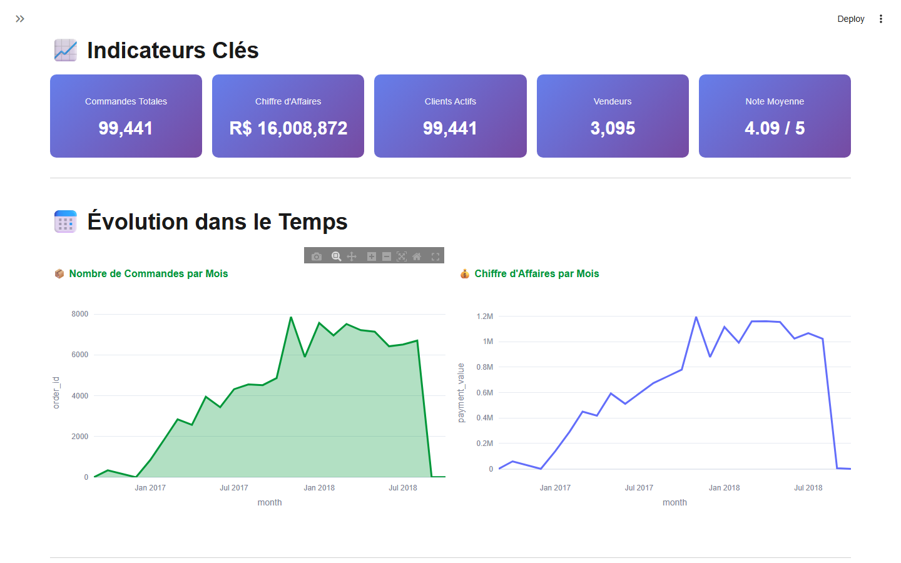
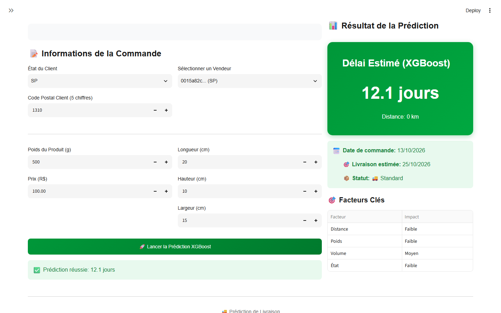
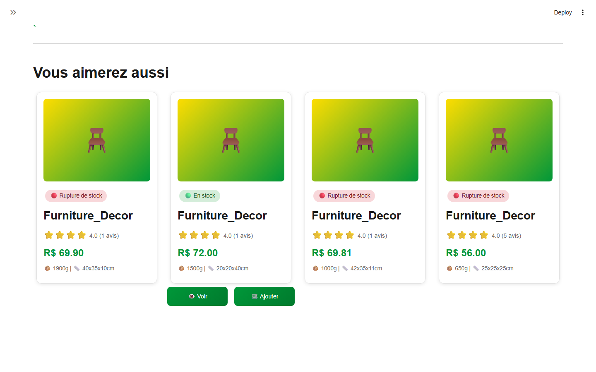

# Olist e-commerce analytics

Four machine learning models built on the public Olist dataset (Brazilian e-commerce, ~100k orders) and served in a Streamlit app: delivery time prediction, review sentiment analysis, order forecasting and product recommendation.



*Admin dashboard: key figures and monthly orders and revenue computed from the Olist data.*



*Delivery time page: prediction from the XGBoost model for an order entered in the form.*



*Product page: the 4 nearest neighbours returned by the KNN model for a furniture product (R$ 71.36, 4.0 stars, 524 reviews).*

## Context

- Academic group project for the *Analytics Edge* course at EMINES (UM6P), January 2026.
- Data: [Brazilian E-Commerce Public Dataset by Olist](https://www.kaggle.com/datasets/olistbr/brazilian-ecommerce) on Kaggle (orders, items, customers, sellers, products, payments and reviews, 2016 to 2018).

## What we built

- **Delivery time prediction**: XGBoost regression of the number of days between purchase and delivery, using order, product, customer/seller location and seller history features (average dispatch time per seller).
- **Review sentiment analysis**: TF-IDF on the Portuguese review text + logistic regression, three classes (negative / neutral / positive), then aggregated per seller to rank shops.
- **Order forecasting**: XGBoost regression of the quantity sold per product and month, with a time-based train / test split (cut-off November 2017).
- **Product recommendation**: k-nearest neighbours (cosine similarity) on product features (category, price, size, reviews) to suggest similar products in the catalogue.
- **Streamlit app**: login with two roles (admin / client), admin dashboard, one page per model, a product catalogue with recommendations, and a page to upload a new model version and roll back to a previous one.

## Results

Metrics on the held-out test sets, as reported in the notebooks and saved in each model's `config.json`:

| Model | Metric |
|-------|--------|
| Delivery time (XGBoost) | MAE 3.42 days, RMSE 4.96 days, R² 0.535 (baseline that predicts the mean: MAE 5.59 days) |
| Sentiment (TF-IDF + logistic regression) | Accuracy 78.8 %, F1 macro 0.673, F1 weighted 0.807 |
| Order forecasting (XGBoost) | R² 0.882, MAE 0.077 units |
| Recommendation (KNN, k = 5) | 32,183 products, 76 features; 98.8 % of recommended products are in the same category as the query product |

## Running it

Requirements: Python 3.11+ (package versions are pinned in `streamlit_app/requirements.txt`, scikit-learn and XGBoost must match the saved models).

```bash
git clone https://github.com/RedaMohssine/olist-ecommerce-analytics.git
cd olist-ecommerce-analytics
python -m venv venv
source venv/bin/activate              # Windows: venv\Scripts\activate
pip install -r streamlit_app/requirements.txt kagglehub

python scripts/download_data.py       # downloads the 9 Olist CSV files into Data/
cd streamlit_app
streamlit run app.py
```

The app opens on `http://localhost:8501`. The trained models are included in `streamlit_app/models/`, so the notebooks do not need to be re-run.

Demo accounts, created locally in a SQLite file on first run:

| Role | Username | Password |
|------|----------|----------|
| Admin (all pages) | `admin` | `admin123` |
| Client (catalogue only) | `client` | `client123` |

## Repository structure

```
notebooks/
  01_eda.ipynb                          exploratory analysis of the 9 tables
  02_delivery_time_prediction.ipynb     XGBoost delivery time model
  03_sentiment_analysis.ipynb           TF-IDF + logistic regression on reviews
  04_order_forecasting.ipynb            monthly quantity forecast per product
  05_product_recommendation_knn.ipynb   KNN recommendation model
  figures/                              evaluation plots saved by the notebooks
streamlit_app/
  app.py                                entry point
  pages/                                login, dashboard, one page per model, catalogue, model management
  components/                           auth, sidebar, charts, translations
  utils/                                data loading and model wrappers
  models/                               trained models and their config.json (metrics)
  database/auth_db.py                   SQLite users table and demo accounts
scripts/download_data.py                downloads the dataset from Kaggle
Data/                                   raw CSV files (not versioned, see Data/README.md)
sample_shipping_batch.csv               example file for batch delivery predictions
```

## Limitations

- The delivery model explains about half of the variance (R² 0.535): delays depend on events that are not in the data (carrier, weather, strikes).
- The order forecasting model fits the training set almost perfectly (R² 0.999 vs 0.882 on test), a sign of overfitting that more regularization or a simpler model could reduce.
- The sentiment model is weak on the neutral class (F1 0.35, against 0.79 for negative and 0.89 for positive): neutral reviews are rare (9 % of the test set) and close to the other two classes.
